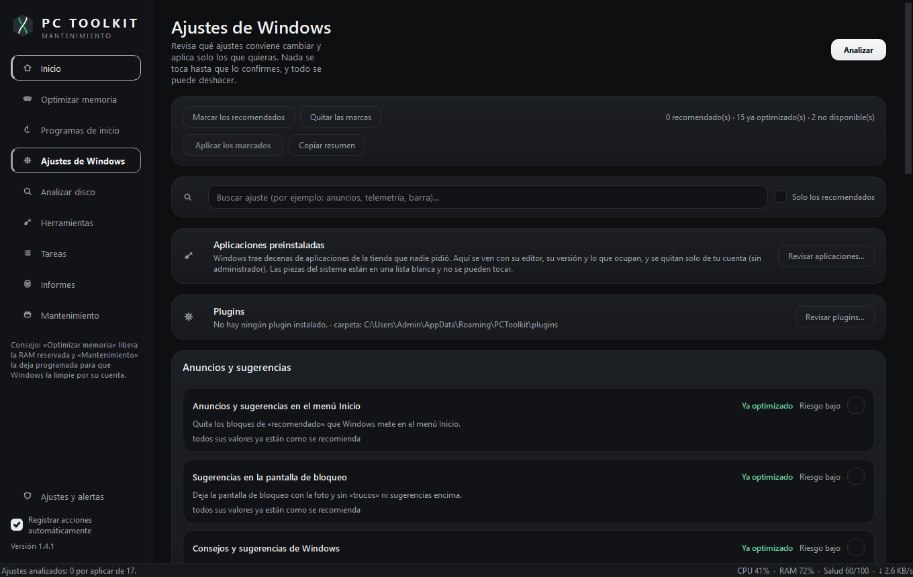

<div align="center">

# PC Toolkit

**Mantenimiento y diagnóstico para Windows, sin ruido.**

Libera RAM, controla lo que arranca con Windows, programa el mantenimiento, mide el equipo en vivo
y exporta informes. Python + PySide6 con un **módulo nativo en C++**, un solo `.exe`, instalación por
usuario y **sin permisos de administrador**.

[](https://github.com/fedegudi2022-blip/PC-Toolkit/releases/latest)
[](https://github.com/fedegudi2022-blip/PC-Toolkit/releases)
[](https://github.com/fedegudi2022-blip/PC-Toolkit/actions/workflows/integracion.yml)
[](LICENSE)
[](#descargar)
[](#desde-el-c%C3%B3digo)

[Descargar](#descargar) · [Qué hace](#qué-hace) · [Capturas](#capturas) · [Desde el código](#desde-el-código) · [Documentación](DOCUMENTACION.md)


</div>

## Descargar

Windows 10 u 11 (x64). No hace falta instalar Python ni nada más.

| Archivo | Qué es |
| --- | --- |
| [`PC-Toolkit-1.5.0-Setup.exe`](https://github.com/fedegudi2022-blip/PC-Toolkit/releases/download/v1.5.0/PC-Toolkit-1.5.0-Setup.exe) | **Recomendado** (85,8 MB). Asistente con la aplicación dentro: accesos directos, arranque automático opcional y desinstalador. Por usuario, sin avisos de Windows. |
| [`PC-Toolkit-1.5.0-portable.exe`](https://github.com/fedegudi2022-blip/PC-Toolkit/releases/download/v1.5.0/PC-Toolkit-1.5.0-portable.exe) | Versión portátil (48,0 MB). Doble clic y funciona, sin instalar ni dejar rastro. |

Datos y preferencias se guardan en `%APPDATA%\PCToolkit` (véase [Dónde se guardan los datos](#dónde-se-guardan-los-datos)).

> Los ejecutables **no van firmados** con un certificado de confianza pública, así que SmartScreen
> puede pedir confirmación la primera vez («Más información» → «Ejecutar de todas formas») y algún
> antivirus mirarlo de más. El SHA-256 de cada archivo está en la
> [nota de la versión](https://github.com/fedegudi2022-blip/PC-Toolkit/releases/latest).

## Qué hace

| Módulo | Qué hace |
| --- | --- |
| **Inicio** | Medidores de CPU, memoria, disco y red, salud del equipo, gráfica de las últimas 24 h, procesos que más consumen y **avisos propios** («la CPU lleva 12 minutos al 88 %», «quedan 4 GB libres», «tienes 12 programas de inicio pesados») que se pueden descartar y **resolver desde el propio aviso**: el de espacio abre la limpieza con lo que señala ya marcado (sin borrar nada hasta confirmarlo), el de memoria la libera al momento, el de programas de inicio pesados los desactiva —los dos **preguntando antes** y con vuelta atrás en «Deshacer»— y el de disco ofrece además el analizador. |
| **Optimizar memoria** | Libera RAM recortando conjuntos de trabajo y cachés, a mano o al pasar un umbral; mide lo liberado de verdad. |
| **Programas de inicio** | Lo que abre Windows al encender: desactiva sin borrar, avisa de entradas muertas y todo se puede deshacer. |
| **Ajustes de Windows** | Catálogo de ajustes de anuncios, privacidad, telemetría, interfaz y rendimiento: **analiza** sin tocar nada, enseña qué está recomendado y con qué riesgo —y **de dónde viene** cada valor (**Predeterminado** o **Personalizado**)—, y aplica solo lo que se marca y se confirma. Cada ajuste se puede devolver **solo él** a como vino Windows, y lo marcado se guarda en un **perfil** (`.pctkperfil`) para llevarlo a otro equipo. Con ayuda por ajuste (`F1`), respaldo `.reg`, gestor de **aplicaciones preinstaladas** y **plugins** en JSON. |
| **Mantenimiento** | Tarea propia en el Programador de Windows (limpieza, memoria e informes) con estado real leído del sistema. |
| **Alertas y bandeja** | Icono en la bandeja, umbrales de CPU, memoria y disco —con lo que marca el equipo **al lado de cada uno**—, aviso por notificación y «Ajustes y alertas» con buscador, valores recomendados y aviso de cambios sin guardar. La ventana **recuerda su tamaño, su sitio y si estaba maximizada**. |
| **Analizar disco** | Escaneo por carpetas con barras proporcionales, uso por categoría y archivos grandes. |
| **Herramientas** | 28 accesos directos a las utilidades de Windows, con buscador y **liberador de espacio** propio: mide (temporales del usuario y de Windows, cachés de los navegadores, miniaturas, volcados de error y papelera), enseña cuánto liberaría **antes de borrar nada** y puede **programar la limpieza de lo marcado** en su propia tarea de Windows, sin activar el mantenimiento completo. |
| **Tareas** | Registro de mantenimiento con estados, prioridades, fechas límite y estadísticas. |
| **Informes** | Exportación a HTML (visual), CSV y JSON, con selección de contenido y destino, incluidos los cambios de los ajustes de Windows. |
| **Actualizaciones** | Al arrancar comprueba si hay una versión nueva (como mucho una vez al día), enseña qué cambia y la instala **verificando antes su SHA-256**. Se puede desactivar o pedir a mano desde Ajustes. |

Dos temas completos —oscuro «grafito» (fondo casi negro y grises fríos, cada nivel de superficie
separado del siguiente) y claro «papel»— que se cambian **sin rehacer la ventana**: la que está
abierta se vuelve a pintar con la paleta nueva (iconos, arcos, insignias y estilos en línea), así que
no hay parpadeo ni foco perdido. Por defecto abre en oscuro y en **Ajustes y alertas → Apariencia** se
puede seguir a Windows —**y seguirle de verdad**: el programa escucha el aviso con el que Windows
cuenta el cambio de tema, así que si lo cambias con la aplicación abierta el nuevo se aplica al
momento, sin reiniciarla— o pasar al claro. El acento es neutro
—casi blanco en el tema oscuro y tinta en el claro— y manda en los botones principales y el foco.
El color tiene significado: **verde** para lo saludable, **ámbar** para los avisos y **rojo** para
los errores. Los datos llevan cuatro tonos propios (CPU azul, memoria cian, disco naranja y red gris
azulado) que se distinguen entre sí y de los estados también con daltonismo. Todo se maneja con el
teclado (`Ctrl+1`…`Ctrl+9` para las secciones, `Ctrl+0` para ajustes; `Tab` e `Intro` alcanzan
también tarjetas y filas). Los textos de las dos paletas cumplen el contraste 4,5:1 de la WCAG y lo
que ocurre se anuncia a los lectores de pantalla.

Medido en un Windows 11 x64: liberar RAM bajó del **78,9 % al 63,6 %** (+1.212 MB en 0,84 s), y con
la ventana en la bandeja el consumo baja a **0,45 % de un núcleo** frente al 2,25 % con la ventana a
la vista (`.venv\Scripts\python.exe tools\medir_consumo.py`).

## Ajustes recomendados de Windows

<div align="center">



</div>

La sección **Ajustes de Windows** funciona como una revisión: primero se **analiza** (solo lectura,
nada se toca), luego se **revisa** qué está recomendado y qué ya está optimizado —cada ajuste con
su categoría, su riesgo (bajo, medio o alto) y un escudo si toca `HKEY_LOCAL_MACHINE`— y solo
entonces se **aplica**, únicamente lo que se haya marcado y confirmado. Se puede preguntar por
cualquier ajuste con `F1`, con el botón «?» o con el clic derecho: se explica qué cambia, por qué se
recomienda, qué claves del registro toca, **cuál es su valor de fábrica** y cómo se revierte.

Cada ajuste dice dos cosas distintas: su **estado** (Recomendado, **Personalizado**, Ya optimizado,
No disponible o Sin analizar) y un **distintivo** con **de dónde viene** el valor que hay puesto —
**Predeterminado**, el de fábrica de Windows, o **Personalizado**, que no es ni el de fábrica ni el
recomendado porque lo cambió otro programa o se puso a mano—. Sin ese dato (cuando Windows no
documenta cuál es) el ajuste se queda sin distintivo en vez de afirmar algo que no se sabe. Y de ahí
sale una acción que antes no existía: **«Dejar como vino Windows»** en la fila del ajuste, que
devuelve **solo ese** a su valor de fábrica —o borra el valor, si Windows no lo trae— con su respaldo
`.reg` y su apunte en «Deshacer», sin tocar los demás.

Cada ajuste aplicado se guarda **tres veces**: en el historial de cambios reversibles (página de
Inicio, junto al resto del programa), en un archivo `.reg` con lo que había antes —se puede restaurar
a mano con doble clic, sin abrir PC Toolkit— y en un registro de cambios legible
(`%APPDATA%\PCToolkit\ajustes_windows.jsonl`) del que sale el botón «Copiar resumen», pensado para
pedir ayuda en un foro. Si algo es de riesgo medio o alto, se ofrece un punto de restauración de
Windows antes de empezar (cuando hay permisos de administrador).

Dos cosas más viven dentro de esta sección:

- **Aplicaciones preinstaladas (debloat).** Lista las aplicaciones de la tienda que trae Windows con
  su editor, su versión y lo que ocupan, y quita las que se marquen **solo del usuario actual** (con
  el mismo `Remove-AppxPackage` de Windows, sin permisos de administrador y sin tocar las cuentas de
  los demás). Una lista blanca —tienda, instalador de paquetes, marcos de trabajo, componentes del
  shell y extensiones de imagen y vídeo— no se puede tocar y explica por qué; cada aplicación dice
  qué se pierde si se quita, y quitarlas queda en el historial para reinstalarlas.
- **Perfiles.** Lo que se ha marcado se guarda en un archivo (`.pctkperfil`, JSON legible) junto con
  la limpieza y el mantenimiento elegidos, para llevarlo a otro equipo. **Abrir un perfil no aplica
  nada**: enseña de dónde salió, qué trae, qué ya está puesto en este equipo, qué no se puede aplicar
  aquí y qué no conoce esta versión, y **marca las casillas** para revisarlas y aplicarlas con el
  mismo botón y el mismo respaldo que si se hubieran marcado a mano. Un archivo de un formato más
  nuevo, o que no sea un perfil, se rechaza entero con el motivo.
- **Plugins.** Ajustes propios en un archivo JSON dentro de `%APPDATA%\PCToolkit\plugins`, sin
  tocar el programa: hay un botón que escribe una plantilla lista para editar. Se validan de forma
  estricta (categoría, riesgo, tipo de valor, HKCU/HKLM…) y un archivo mal escrito se rechaza entero
  con el motivo, sin cargarse a medias. Sus ajustes **no se pueden aplicar hasta que el plugin se
  revisa y se acepta** en su ventana, que enseña las claves que toca y avisa de los que necesitan
  administrador o son de riesgo alto; la aceptación guarda la huella del archivo, así que si el JSON
  cambia después hay que revisarlo otra vez.

Ejemplo mínimo de plugin (el que escribe la plantilla):

```json
{
  "esquema": 1,
  "id": "mis-ajustes",
  "nombre": "Mis ajustes",
  "autor": "Tu nombre",
  "version": "1.0",
  "ajustes": [
    {
      "id": "sin-anuncios-inicio",
      "nombre": "Quitar los anuncios del menú Inicio",
      "categoria": "anuncios",
      "descripcion": "Deja de mostrar aplicaciones sugeridas en el menú Inicio.",
      "riesgo": "bajo",
      "requiere_admin": false,
      "claves": [
        {
          "hive": "HKCU",
          "path": "Software\\Microsoft\\Windows\\CurrentVersion\\ContentDeliveryManager",
          "nombre": "SubscribedContent-338388Enabled",
          "tipo": "dword",
          "recomendado": 0
        }
      ]
    }
  ]
}
```

### Créditos

La idea de un catálogo de ajustes de Windows que se analizan, se revisan y se aplican con vuelta
atrás —y la de un gestor de aplicaciones preinstaladas y de definiciones que el usuario aporta en
un archivo— está inspirada en **[CrapFixer](https://github.com/builtbybel/CrapFixer)** (builtbybel,
licencia MIT). **No se ha copiado código suyo**: el catálogo, la detección, la lista blanca, el
validado de plugins y la vuelta atrás son código propio escrito para la arquitectura de PC Toolkit
(lógica sin interfaz en `pctoolkit/core`, datos en `%APPDATA%\PCToolkit`, cambios reversibles y sin
permisos de administrador por defecto).

## Capturas

<table>
<tr>
<td width="50%"><br><sub>Optimizar memoria</sub></td>
<td width="50%"><br><sub>Programas de inicio</sub></td>
</tr>
<tr>
<td><br><sub>Mantenimiento programado</sub></td>
<td><br><sub>Analizar disco</sub></td>
</tr>
<tr>
<td><br><sub>Tema claro</sub></td>
<td><br><sub>Instalador</sub></td>
</tr>
</table>

Ejemplo de informe con datos reales: [capturas/informe_muestra.html](capturas/informe_muestra.html).

## Desde el código

Requisitos: Windows 10 u 11 (x64), Python 3.10+ y las dependencias de
[requirements.txt](requirements.txt) (`PySide6`, `psutil`).

```bat
run.bat                              Crea el entorno, instala lo que falta y abre la aplicación
```

```bat
py -m venv .venv
.venv\Scripts\python.exe -m pip install -r requirements.txt
.venv\Scripts\python.exe app.py
```

Opciones útiles de `app.py`:

```bat
python app.py --demo                       Carga tareas de ejemplo
python app.py --analizar C:\Datos           Abre analizando esa carpeta
python app.py --tema claro                  Fuerza el tema en esa ejecución
python app.py --screenshot salida           Guarda una captura de cada página y sale
python app.py --mantenimiento               Mantenimiento desatendido y sale (lo usa la tarea)
python app.py --limpieza --categorias temp  Limpieza desatendida de esas categorías y sale
```

> Purgar la caché del sistema (la limpieza que más memoria libera) y las categorías de limpieza de
> `C:\Windows` necesitan permisos de administrador; la aplicación lo avisa, las enseña como no
> disponibles y ofrece reiniciarse elevada. El resto funciona sin permisos.

## Compilar

```bat
build_exe.bat                            Programa (carpeta autocontenida) + comprobación real
python build_exe.py --onefile            Un único .exe, más cómodo de compartir
build_installer.bat                      Instalador de Windows (un solo archivo, con la app dentro)
```

| Resultado | Tamaño | Arranque |
| --- | --- | --- |
| `dist\PC Toolkit\` (carpeta, 165 archivos) | 77,8 MB (85,7 con el desinstalador) | 0,32 s |
| `dist\PC Toolkit.exe` (`--onefile`) | 47,6 MB | 1,88 s |
| `dist\PC Toolkit Setup.exe` | 85,3 MB | instala 167 archivos / 85,7 MB en 8,9 s |

`build_exe.py` recorta del paquete 41,7 MB de librerías de Qt que la aplicación no usa —las de `ssl`
se quedan a propósito, que son las de **https**— y comprueba el resultado **ejecutando el propio
`.exe`**; `build_installer.py` instala de verdad en carpetas temporales —sin tocar el escritorio ni
tu instalación—, ejecuta la copia instalada y desinstala
comprobando que no queda rastro. Con la variante de carpeta hay que copiar **toda** `dist\PC Toolkit`.

### Firma digital

[firmar.py](firmar.py) (o [firmar.bat](firmar.bat) con doble clic) localiza `signtool`, firma los
ejecutables de `dist\` con SHA-256 y sello de tiempo RFC 3161, y verifica el resultado. Se puede
firmar en la misma pasada de compilación con `--firmar`.

```bat
firmar.bat --estado           Informe: signtool, certificados y firmas actuales
firmar.bat --traer-signtool   Descarga signtool del paquete oficial de Microsoft y sale
firmar.bat --autoprueba       Prueba el proceso con un certificado autofirmado
firmar.bat --comprobar        Falla (código 1) si algo no está bien firmado
build_installer.py --rebuild --firmar --huella 1A2B3C…
```

Para firmar en un servidor de compilación está [.github/workflows/firmar.yml](.github/workflows/firmar.yml),
que compila en Windows y firma con **Azure Artifact Signing** por identidad federada OIDC (sin
certificados ni claves en GitHub). Qué hay que preparar una vez, y cómo firmar con la clave en un
token o HSM: [DOCUMENTACION.md](DOCUMENTACION.md), apartado 8.10.

## Actualizaciones

La aplicación mira si hay una versión nueva **al arrancar** (como mucho una vez al día, y solo si
está activado) y, cuando la hay, enseña qué cambia y ofrece instalarla. Descargar e instalar es
siempre una decisión tuya: nada se baja ni se ejecuta sin aceptar.

- El instalador se descarga a una carpeta temporal, se **comprueba su SHA-256** contra el que
  publica la versión y solo entonces se ejecuta; si el hash no coincide, el archivo se borra y se
  avisa. Una versión que no publique su hash no se actualiza sola.
- Se instala **encima** de la versión que tengas, conservando tus datos y preferencias, y la
  aplicación se cierra sola y vuelve a abrirse con la versión nueva. Si usas la versión portátil, no
  se instala nada: se abre la página de la versión para que la descargues a mano.
- En **Ajustes y alertas → Actualizaciones** hay un botón «Buscar actualizaciones» y un interruptor
  para desactivar la comprobación automática. «Omitir esta versión» deja de avisar de esa versión en
  concreto (una posterior sí volverá a avisar).

### Publicar una versión nueva

Para quien mantiene el proyecto, publicar una versión son tres pasos:

1. Subir la versión en `pctoolkit/core/config.py` (`APP_VERSION`): es el único sitio donde se
   escribe, y de ahí salen el ejecutable, el instalador, los nombres de los archivos y la
   comprobación de actualizaciones.
2. Rehacer las capturas de la documentación (`tools\capturar_documentacion.py`) y actualizar los
   recuentos de las guías: llevan la versión dentro y la suite lo comprueba.
3. Empujar `main` y la etiqueta con el mismo número:

```bat
git push origin main
git push origin v1.5.0
```

Antes del día del estreno se puede **ensayar la publicación** con una etiqueta de prueba: en
«Actions → Publicar la versión (Windows) → Run workflow» se lanza el mismo trabajo a mano, que
recorre el camino completo (compilar —incluido el módulo nativo—, suite, instalación real, hashes y
publicación) y lo deja todo en una publicación **en borrador y preliminar**, con etiqueta
`v1.5.0-ensayo`. No sale en
`/releases/latest` —lo que mira el actualizador— y no gasta ningún número de versión.

La etiqueta dispara [.github/workflows/publicar.yml](.github/workflows/publicar.yml), que compila en
un servidor de Windows, pasa la suite completa (incluida la instalación y desinstalación reales),
calcula los SHA-256 y crea la **publicación** con sus archivos adjuntos y sus notas: el instalador,
la versión portátil, cada `.sha256` y `SHA256SUMS.txt`. Si la etiqueta y `APP_VERSION` no coinciden,
el trabajo se para en el primer paso. Las novedades que se escriban en las notas de la publicación
son las que verá quien tenga una versión anterior al actualizar. Para firmar con Azure sigue estando
[.github/workflows/firmar.yml](.github/workflows/firmar.yml) (a mano, con su configuración; véase
[DOCUMENTACION.md](DOCUMENTACION.md), apartado 8.10).

## Dónde se guardan los datos

- `%APPDATA%\PCToolkit`: tareas, historial de métricas (24 h), histórico del mantenimiento, cambios
  reversibles y el XML de la tarea programada.
- `%APPDATA%\PCToolkit\ajustes_windows.jsonl`: registro legible de cada análisis y cada cambio en
  los ajustes de Windows.
- `%APPDATA%\PCToolkit\respaldo_ajustes`: los `.reg` con lo que había antes de aplicar cada ajuste
  (se abren con doble clic para restaurar a mano).
- `%APPDATA%\PCToolkit\plugins`: los ajustes propios en JSON, más `confianza.json` (qué plugins se
  revisaron y con qué huella).
- Registro de Windows, `HKCU\Software\PCToolkit`: preferencias (umbrales, bandeja, tema, modo eco,
  actualizaciones…).
- `Documentos\PCToolkit\Informes`: los informes exportados.

Desinstalar conserva estos datos salvo que se pidan borrar desde el asistente.

## Pruebas

```bat
.venv\Scripts\python.exe tests\smoke_test.py
```

**1048 comprobaciones** sin marco externo: métricas y disco reales, persistencia, alertas,
los **avisos propios** (umbrales, orden, descarte que caduca y vuelve si la cosa empeora, y qué
categorías marca cada uno al abrir la limpieza desde él) y el
**catálogo de limpieza** (vista previa que no borra, archivos en uso que no se prometen, carpetas
peligrosas rechazadas, enlaces que no se siguen, categorías que sobreviven al guardar, papelera
medida sin administrador, la ventana abierta ya marcada desde un aviso —que sigue preguntando antes
de borrar— y la **limpieza programada** con su tarea propia, sus argumentos y su histórico),
historial (con la serie de la GPU, sus huecos y su color neutro), informes en los tres formatos, las
páginas construidas y navegadas, programas de
inicio y cambios reversibles sobre claves propias de la prueba, el ciclo del instalador en carpetas
temporales (incluido **instalar encima de una versión anterior**), que las dependencias que la
compilación importa estén declaradas en `requirements.txt`, la firma (argumentos de `signtool` y
firma real con certificado de prueba), las actualizaciones (comparación de versiones, lectura de una
publicación de GitHub con datos simulados, verificación del SHA-256 —correcta e incorrecta—,
cancelación de la descarga y detección de la versión portátil), el contraste
WCAG, la diferenciación de las series y los estados con daltonismo (CIEDE2000 sobre las matrices de
Machado) y la accesibilidad (roles, nombres, anuncios y foco visible).

Los **ajustes de Windows** se prueban sobre claves de registro propias de la prueba (nunca de las de
deverdad): análisis, aplicación, respaldo `.reg` y vuelta atrás, los distintivos de fábrica y
personalizado, devolver un solo ajuste a su valor de fábrica (incluidas las claves que el ajuste
había creado y el caso del valor que de fábrica no existe), que sin saber el valor de fábrica no se
oferta devolverlo, lo que necesita administrador sin permisos, y el catálogo de la página navegado de
verdad. Los **perfiles** se prueban con archivos de todo tipo —rotos, ajenos, vacíos, de un formato
más nuevo y con campos del tipo que no toca— y por la ventana: que abrir uno marque sus ajustes **sin
aplicar nada**, que la limpieza llegue a su ventana ya marcada y que el mantenimiento vuelva a su
página. El **módulo nativo** se prueba con la DLL compilada: que el listado de aplicaciones salga del
registro sin arrancar PowerShell, que lea ese registro **igual que Python** (una segunda
implementación escrita a mano, como el recorrido del disco), que no pierda ninguna aplicación que no
sea de Windows, que sin módulo se pregunte a PowerShell como antes y que el recorrido del disco dé
**exactamente lo mismo** que el de Python (con un árbol de prueba con enlaces y uniones). En los
recuentos que separa PowerShell de lo que hay en el registro, la diferencia se cuenta y se enseña:
Windows Server guarda las aplicaciones que trae provisionadas solo en su base de datos interna (véase
[DOCUMENTACION.md](DOCUMENTACION.md), apartado 3.12). Las **aplicaciones preinstaladas** y los
**plugins** se prueban con un PowerShell interceptado y una carpeta de plugins temporal: la lista
blanca, los riesgos, que una pieza del sistema no llegue a ejecutar nada, que el nombre del paquete
vaya por variable de entorno y no dentro del comando, la validación campo por campo de los JSON (con
su motivo), que un plugin sin aceptar no se pueda aplicar, que editar el archivo tumbe la confianza y
que aceptar o retirar desde su ventana cambie el estado.

Se ejecutan con la plataforma gráfica real de Qt; en un equipo sin escritorio, `set
PCTOOLKIT_OFFSCREEN=1` las ejecuta sin pantalla (las comprobaciones de desbordes avisarán de más y
no se ejecutan las que necesitan bandeja).

La última comprobación vigila esta misma documentación: que las guías citen la versión actual y que
cada captura se haya hecho con ella. Para rehacerlas: `tools\capturar_documentacion.py`. Esas
guardas están en `tests\documentacion.py`, aparte de las pruebas de código, y se pueden dejar fuera
cuando lo que se comprueba es un cambio de código: `tests\smoke_test.py --sin-documentacion`.

En cada envío las pasa [.github/workflows/integracion.yml](.github/workflows/integracion.yml) en un
servidor de Windows, que además **compila el ejecutable y el instalador**: así un fallo de
compilación —una dependencia sin declarar, un cambio que rompe el empaquetado— se ve al enviar y no
al publicar. No firma nada: de la firma se encarga
[.github/workflows/firmar.yml](.github/workflows/firmar.yml) y de las publicaciones
[.github/workflows/publicar.yml](.github/workflows/publicar.yml) (al empujar una etiqueta `v…`).

## Estructura

```
app.py                       Punto de entrada y opciones de línea de comandos
build_exe.py / .bat          Empaquetado con PyInstaller (icono, versión y comprobación)
build_installer.py / .bat    Instalador de Windows y comprobación del ciclo completo
firmar.py / .bat             Firma con signtool (SHA-256, sello RFC 3161 y verificación)
assets/                      Logotipo original, icono del ejecutable y propiedades de versión
nativo/                      Módulo opcional en C++ (escáner de disco y listado de aplicaciones),
                             con su script de compilación; si no está, todo tira por Python
installer/                   Asistente, desinstalador y lógica de instalación por usuario
tools/                       Icono, medición de consumo, capturas (y su regeneración), verificación de
                             la instalación y de una publicación ya subida (descargándola)
capturas/                    Imágenes de esta documentación
pctoolkit/
  core/                      Lógica sin interfaz: config, métricas, tarjeta gráfica, memoria, disco,
                             tareas, informes, historial, alertas, avisos, limpieza, arranque,
                             mantenimiento, programador, ajustes de Windows, aplicaciones, plugins,
                             el módulo nativo opcional de C++ (`native.py`) y los perfiles
  ui/                        Interfaz PySide6: tema, accesibilidad, iconos, widgets, gráfica,
                             vigía de la GPU, bandeja, diálogos y una página por sección
tests/smoke_test.py          1048 comprobaciones (núcleo, interfaz, instalador, firma, dependencias,
                             logotipo, actualizaciones, ajustes de Windows, perfiles, módulo nativo,
                             aplicaciones, plugins, limpieza, limpieza programada y avisos)
tests/documentacion.py       Guardas de capturas, informe y recuentos (van aparte)
dist/                        Todo lo compilado; se regenera con los scripts
```

Qué hace cada módulo, con detalle: [DOCUMENTACION.md](DOCUMENTACION.md).

## Limitaciones

- **Temperatura:** `psutil` no expone sensores térmicos en Windows, y ni el WMI del sistema ni las
  librerías que sí los leen funcionan sin permisos de administrador y un controlador con firma (y en
  muchos equipos la clase de temperatura ni existe), así que no hay tarjeta de temperatura. La
  **tarjeta gráfica sí** se muestra (y entra como una serie más en el historial de 24 h): su uso por
  motor viene de los contadores de rendimiento de Windows y su nombre y su controlador, del registro
  (en segundo plano, cada 15 s —un minuto en modo eco—; con contadores se sigue leyendo aunque la
  ventana esté oculta, y donde no los haya, solo con la portada o los informes a la vista). La
  lectura **no arranca ningún proceso**: 3 ms de CPU y nada de memoria por vuelta (medidos), con la
  ventana de un segundo que usa el propio Administrador de tareas. Donde Windows no publique ese
  contador, la aplicación se apaña con un solo proceso de PowerShell que reutiliza mientras la
  tarjeta se mira, y sin él, con uno por lectura.
- **Programas de inicio:** los servicios se administran en «Herramientas»; las aplicaciones de la
  Microsoft Store **sí** aparecen, con su tarea de inicio y el nombre que enseña Windows, y se
  activan y desactivan igual que las demás (regla reversible y deshacer). El coste de cada entrada es
  una estimación propia.
- **Permisos:** las herramientas marcadas con escudo piden UAC; si se cancela, la aplicación lo dice
  sin cerrarse. En los ajustes de Windows, lo que toca `HKEY_LOCAL_MACHINE` no se analiza ni se
  aplica sin permisos: aparece como «no disponible» con el motivo, en vez de ofrecerse y fallar.
- **Aplicaciones preinstaladas:** se listan y se quitan las del **usuario actual**; quitar una para
  todos los usuarios, o volver a instalar una que la tienda ya no publique, no se hace desde aquí.
  Al quitarlas, el tamaño que se enseña es lo que se pudo medir en unos segundos (una aplicación con
  miles de archivos se cuenta hasta agotar ese tiempo), y el editor y la versión son los que publica
  el propio paquete.
- **Plugins:** son archivos del usuario, así que un plugin puede declarar cualquier ajuste que el
  registro permita escribir. Por eso se validan campo por campo, sus ajustes no se aplican hasta
  aceptarlo, y la aceptación caduca si el archivo cambia. PC Toolkit no ejecuta código de un plugin:
  solo lee su JSON.
- **Limpieza:** el catálogo mide siete categorías y limpia las que se marquen. Lo reciente no se
  toca (una hora como mínimo) y lo que está en uso se omite y se dice. Las **cachés de navegador**
  solo se limpian con ese navegador cerrado (y nunca tocan el perfil: contraseñas, cookies y
  marcadores quedan donde están); los **temporales de Windows** y la **caché de Windows Update**
  necesitan administrador, y por eso se ofrecen como no disponibles con su motivo cuando no lo hay (la
  caché de Windows Update, además, no se marca sola: Windows la administra y borrarla con una
  actualización a medias puede dejarla a medio instalar). La **papelera** no se puede deshacer: viene
  sin marcar y lo avisa antes de vaciarla. El mantenimiento automático limpia solo lo que se elija en
  esa ventana (de fábrica, los temporales del usuario, como antes).
- **Bandeja:** si el sistema no la tiene, todo funciona igual salvo el segundo plano, y se avisa.
- **Actualizaciones:** necesitan conexión con GitHub. La versión portátil no se instala sola (no hay
  instalación que reemplazar): la aplicación ofrece abrir la página de la versión para descargarla.

## Licencia

[MIT](LICENSE): puedes usar, modificar y redistribuir el código, incluso comercialmente, conservando
el aviso de copyright y la licencia.
