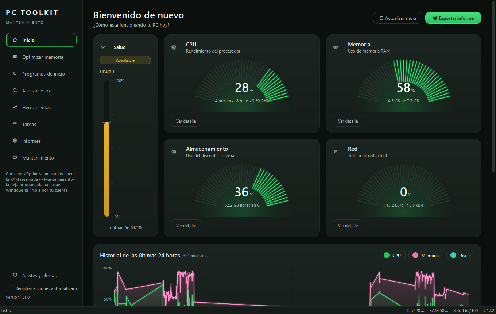
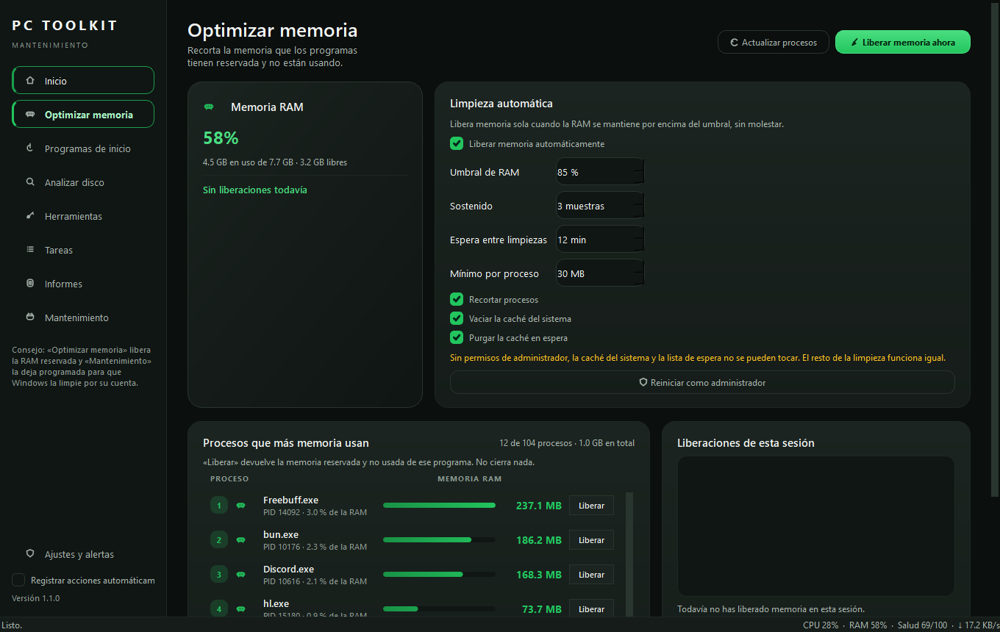
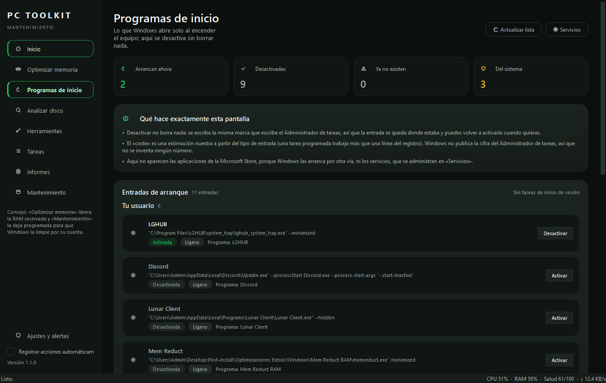
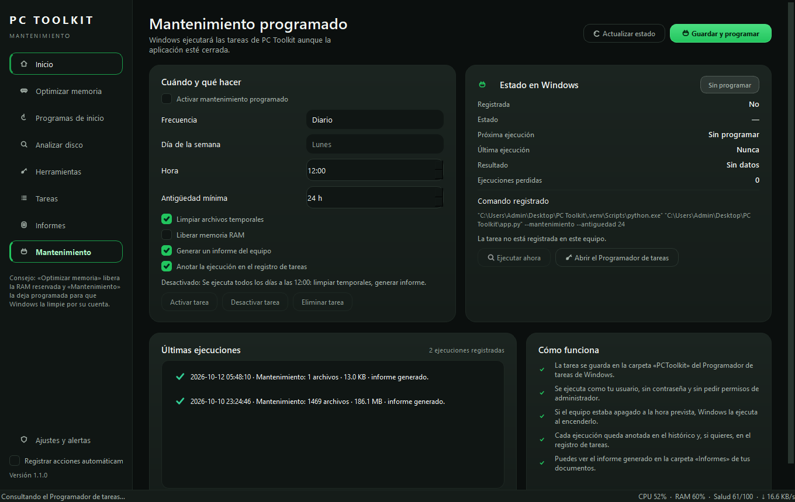
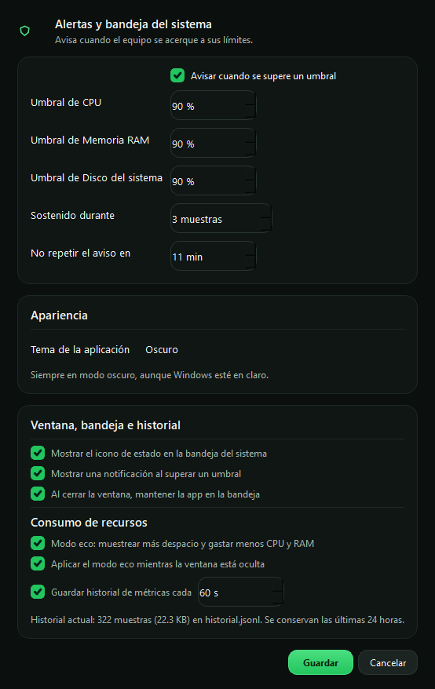
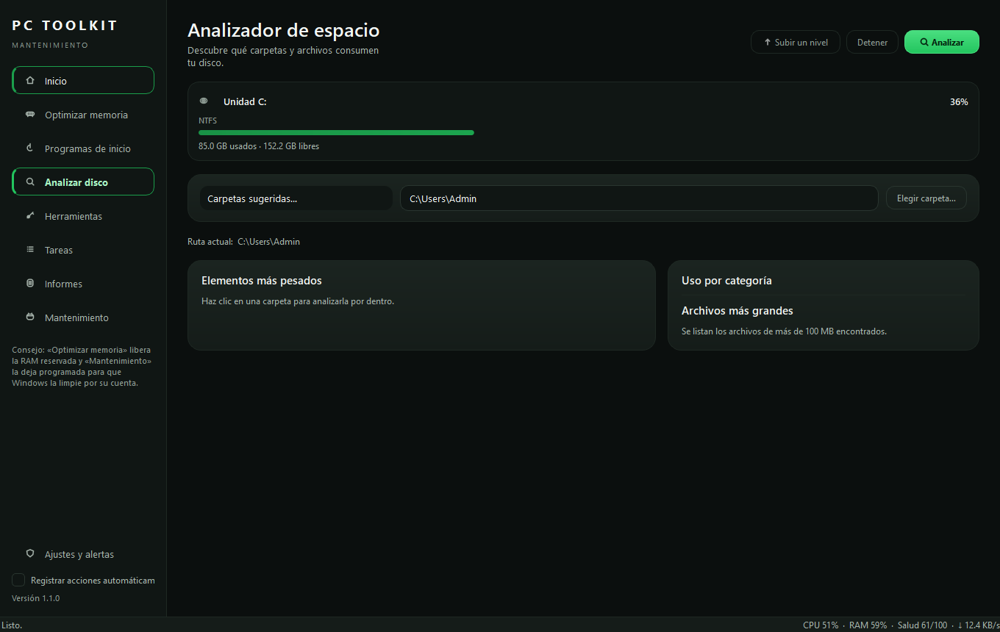
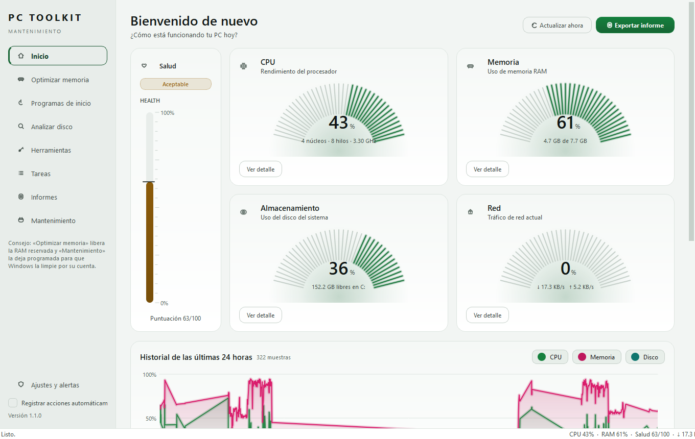
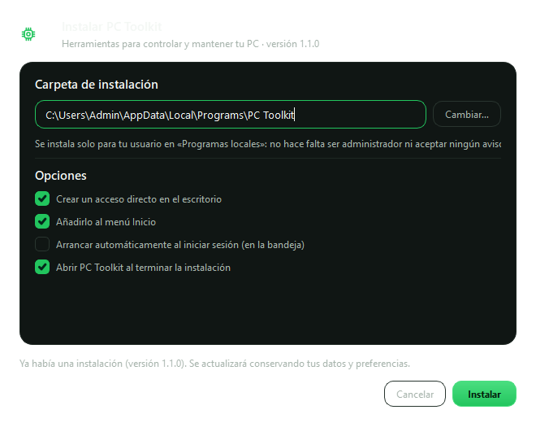

# PC Toolkit — optimizador y caja de herramientas para Windows

Aplicación de escritorio para **optimizar y mantener tu PC**: libera memoria RAM cuando hace
falta, deja el mantenimiento programado en Windows, muestra métricas en vivo, analiza el espacio
en disco, reúne accesos directos a las herramientas del sistema y exporta informes.

Construida con **Python + PySide6 + psutil**, con tema oscuro «grafito frío» (grises neutros con un
matiz verde muy leve, cada nivel de superficie bien separado del siguiente), verde de acento para
las acciones y los estados saludables, ámbar para los avisos y rojo para los errores; tarjetas,
medidores tipo abanico y navegación lateral.



## Funciones

| Módulo | Qué hace |
| --- | --- |
| **Inicio** | Medidores de CPU, memoria, disco del sistema y red, puntuación de salud del equipo, gráfica del historial de las últimas 24 horas, detalles del sistema y procesos con más consumo. |
| **Optimizar memoria** | Libera RAM recortando los conjuntos de trabajo de los procesos y vaciando la caché del sistema (estilo MemReduct), a mano o **automáticamente** al superar un umbral; incluye limpieza por proceso y medida real de lo liberado. |
| **Programas de inicio** | Lista lo que Windows abre solo al encender el equipo (registro, carpetas de inicio y tareas al iniciar sesión), avisa de las entradas que apuntan a programas que ya no están y **desactiva sin borrar nada**, con cada cambio apuntado para poder deshacerlo. |
| **Mantenimiento** | Crea una tarea en el **Programador de tareas de Windows** para limpiar temporales, liberar memoria y generar informes sin abrir la aplicación; muestra próxima ejecución, último resultado e histórico. |
| **Alertas y bandeja** | Icono de estado en la bandeja del sistema, avisos cuando la CPU, la memoria o el disco superan umbrales configurables, y opción de mantener la app en segundo plano al cerrar la ventana. |
| **Analizar disco** | Escaneo por carpetas con barras proporcionales, uso por categoría (vídeo, imágenes, programas…), archivos grandes y navegación hacia dentro con doble clic. |
| **Herramientas** | 28 accesos directos agrupados por categoría (sistema, mantenimiento, almacenamiento, red y avanzado), buscador y limpieza rápida de archivos temporales. |
| **Tareas** | Registro de mantenimiento con estados, prioridades, fechas límite, plantillas rápidas y estadísticas de progreso. |
| **Informes** | Exportación a **HTML** (informe visual), **CSV** (Excel) y **JSON** con selección de contenido y destino. |

## Optimizar memoria (liberación de RAM)



Tres técnicas, aplicadas de menos a más agresiva y siempre midiendo antes y después:

1. **Recortar los conjuntos de trabajo** de los procesos (`EmptyWorkingSet`): devuelve a Windows
   la memoria reservada que nadie está usando. Es la parte segura y funciona sin permisos extra.
2. **Vaciar la caché del sistema** (`MemoryEmptyWorkingSets`).
3. **Purgar la caché en espera** (`MemoryPurgeStandbyList`), lo que más memoria libera. Las dos
   últimas necesitan privilegios, así que si la app no es administradora lo avisa y ofrece un
   botón para **reiniciarse como administrador** (UAC).

Lo que puedes configurar:

- **Umbral** de RAM (por defecto 85 %), **muestras sostenidas** y **espera entre limpiezas** para
  que la limpieza automática no entre en bucle.
- **Consumo mínimo por proceso**: no se tocan los procesos pequeños (no aportan nada).
- Los procesos críticos (System, Registry, csrss, lsass, dwm…) **no se tocan nunca**, y el propio
  PC Toolkit tampoco se recorta a sí mismo salvo que se pida.

La lista **«Procesos que más memoria usan»** muestra los doce procesos que más RAM gastan con su
puesto, el PID, el porcentaje de la RAM total, una barra comparada con el que más consume y la cifra
exacta; cada fila tiene su botón **Liberar** para recortar solo ese proceso. Se ven siete filas
enteras de un vistazo y ninguna queda cortada ni tapa su botón.

Medición real en este equipo (Windows 11 x64, 32 GB): de **78,9 % a 63,6 % de RAM**, 36 procesos
recortados y **+1 212 MB disponibles** en 0,84 s. La tarjeta muestra la cifra liberada, el antes y
el después, los procesos tocados y el histórico de la sesión.

> Es un recorte de memoria en caché, no memoria nueva: los programas recargan de disco lo que
> necesiten. Por eso el umbral es alto y la limpieza automática espera entre pasadas.

## Programas de inicio (lo que arranca con Windows)



Lista todo lo que Windows abre solo al encender el equipo, con el origen de cada entrada (tu
usuario, todos los usuarios, las carpetas de inicio o una tarea al iniciar sesión) y **desactiva lo
que sobra sin borrar nada**: escribe la misma marca que escribe el Administrador de tareas, así que
la entrada se queda donde estaba, Windows deja de ejecutarla y se puede volver a activar desde aquí,
desde el Administrador de tareas o con el botón **Deshacer**.

- **Origen y estado real** de cada entrada: claves `Run` y `RunOnce` del usuario y del sistema
  (incluidas las de 32 bits), carpetas de inicio y tareas con disparador «al iniciar sesión».
- **Entradas muertas a la vista**: si el programa al que apunta ya no está en el equipo, la fila lo
  dice; desactivarla no cambia nada más y limpia el arranque.
- **Coste estimado** (Ligero o Medio) según el tipo de entrada, con la explicación a mano: es una
  estimación propia, porque Windows no publica la cifra que muestra el Administrador de tareas.
- **Todo reversible**: cada cambio se apunta con su fecha en la tarjeta *Deshacer* y se puede
  revertir con un clic, incluso después de cerrar y volver a abrir la aplicación.
- Las entradas de **todos los usuarios** piden permisos: la app lo avisa y ofrece reiniciarse como
  administrador en lugar de intentarlo a escondidas.

Lo que **no** aparece: las aplicaciones de la Microsoft Store (Windows las arranca por otra vía, sin
una clave pública estable) y los servicios, que se administran en *Herramientas → Servicios*.

## Mantenimiento programado de Windows



El botón **Guardar y programar** registra una tarea en el Programador de tareas de Windows
(carpeta `\PCToolkit\`) que ejecuta el modo desatendido de la aplicación:

- Se ejecuta **como tu usuario**, sin contraseña y **sin privilegios elevados**.
- **Diario**, **semanal** (con día) o **al iniciar sesión**, a la hora que elijas.
- Si el equipo estaba apagado a la hora prevista, Windows la recupera al encenderlo.
- Pasos configurables: limpiar temporales (con antigüedad mínima), liberar memoria RAM, generar un
  informe del equipo y anotar la ejecución en el registro de tareas.
- La página muestra el estado real leído de Windows (próxima ejecución, última, código de
  resultado, ejecuciones perdidas), permite activar, desactivar, ejecutar ahora o eliminar la tarea,
  y avisa si el comando registrado ya no coincide porque hayas movido la aplicación.
- Ese estado se lee **al abrir la página**: arrancar la aplicación no lanza ninguna consulta (útil si
  solo quieres dejarla en la bandeja). Mientras no se ha preguntado a Windows verás «Sin consultar»
  con la explicación, y **Actualizar estado** lo relee cuando quieras.

El modo desatendido también se puede lanzar a mano:

```bat
python app.py --mantenimiento                 Limpia temporales y genera informe
python app.py --mantenimiento --liberar-memoria   Además libera RAM
python app.py --mantenimiento --simular       Muestra lo que haría sin cambiar nada
python app.py --mantenimiento --sin-limpieza --sin-informe --sin-registro
python app.py --mantenimiento --antiguedad 72 Solo temporales de más de 72 horas
```

## Consumo de recursos

La aplicación se adapta a lo que estás mirando:

- **Perfil completo** (ventana a la vista): muestreo cada 1,2 s y lista de procesos solo cuando la
  página que la necesita está visible.
- **Perfil eco** (ajustable en **Ajustes y alertas**): muestreo cada 3,5 s sin desglose por núcleo.
- **Modo eco automático** al ocultar la ventana o dejarla en la bandeja: nadie mira las gráficas,
  así que se baja el ritmo y se dejan de repintar las páginas.

Medido con [tools/medir_consumo.py](tools/medir_consumo.py) (16 s por perfil, datos de usuario en
una carpeta temporal):

| Perfil | CPU (% de un núcleo) | RAM | Actualizaciones | Procesos leídos |
| --- | --- | --- | --- | --- |
| Completo (a la vista) | 2,79 % | 103,3 MB | 13 | sí |
| Eco (a la vista) | 1,23 % | 102,6 MB | 4 | sí |
| En segundo plano (bandeja) | **0,52 %** | 97,6 MB | 4 | no |

En segundo plano el consumo baja un **81 %** respecto al muestreo completo. Reproducible con
`.venv\Scripts\python.exe tools\medir_consumo.py`.

## Bandeja del sistema, alertas e historial

El icono de la bandeja muestra tres barras (CPU, memoria y disco) coloreadas según la carga; al
pasar el ratón resume el estado completo y su menú permite abrir la ventana, ver las métricas,
activar o desactivar las alertas o salir por completo de la aplicación.

Las alertas se configuran desde **Alertas y bandeja** en la barra lateral (o desde el menú del
icono):

- **Umbrales independientes** de CPU, memoria y disco (por defecto 90 %).
- **Muestras sostenidas**: cuántas lecturas seguidas deben superar el umbral antes de avisar,
  para no molestar con picos puntuales.
- **Enfriamiento**: minutos mínimos entre dos avisos del mismo tipo.
- Al bajar del umbral la cuenta se reinicia, de modo que un nuevo episodio vuelve a avisar.
- Los avisos aparecen como notificación de Windows y también en la barra de estado.

Con la bandeja activa, cerrar la ventana mantiene PC Toolkit en segundo plano controlando el
equipo; para cerrarla del todo hay que usar **Salir** en el menú del icono.

El **historial** guarda una muestra cada 30 segundos (configurable) en
`%APPDATA%\PCToolkit\historial.jsonl` y conserva 24 horas: en el inicio se dibuja con una
línea por métrica, leyenda para ocultar series, media y máximo de cada una, y un cursor que al
pasar por encima muestra los valores exactos de ese instante.

Configuración de alertas, bandeja, modo eco e historial:



Analizador de disco:



Ejemplo del informe HTML generado con datos reales: [capturas/informe_muestra.html](capturas/informe_muestra.html)

## Apariencia: clara, oscura o la de Windows

La aplicación trae **dos temas completos** y, por defecto, sigue al sistema:

- **Seguir a Windows** (opción por defecto): usa el mismo modo claro u oscuro que tenga el
  escritorio y cambia con él al reiniciar la aplicación. Se lee de
  `HKCU\Software\Microsoft\Windows\CurrentVersion\Themes\Personalize` (`AppsUseLightTheme`), que es
  la misma marca que usa Windows.
- **Oscuro** «grafito frío»: gris muy oscuro con un matiz verde muy leve y el texto casi blanco.
- **Claro** «niebla verde»: blancos fríos de la misma familia y el mismo verde, oscurecido para
  que siga leyéndose como texto y como relleno con texto blanco encima.

El color se usa por **significado**: verde para la acción principal, la selección activa y el estado
saludable; ámbar para lo que pide atención; rojo para errores y estados críticos. Los datos (CPU,
memoria y disco) llevan tres tonos propios —verde, rosa y turquesa— que se distinguen en la gráfica
y en la leyenda sin parecer una alerta cuando el valor es normal.



Se cambia en **Ajustes y alertas → Apariencia** (`Ctrl+9`), que además explica en una línea qué
supone cada opción *según cómo esté Windows en ese momento*. El cambio se aplica al instante: la
ventana se vuelve a montar con la paleta nueva, sin cerrar la aplicación ni perder lo que estabas
haciendo.

Para probarlo sin tocar las preferencias guardadas:

```bat
python app.py --tema claro      Abre en claro (también vale oscuro o auto)
python app.py --tema oscuro     Fuerza el tema oscuro en esta ejecución
```

Las dos paletas se comprueban con la **fórmula de contraste de la WCAG**: ningún texto baja de
4,5:1 sobre el fondo en el que se usa, ni siquiera el de la barra lateral seleccionada (que en el
tema claro usa un verde oscuro en vez del brillante, porque el brillante sobre blanco no se lee).

## Teclado y accesibilidad

La aplicación se maneja entera con el teclado y **el foco siempre se ve** (el borde del control se
ilumina en verde), así que no hay que adivinar dónde está el cursor:

| Atajo | Acción |
| --- | --- |
| `Ctrl+1` … `Ctrl+8` | Abre cada sección en el orden de la barra lateral (Inicio, memoria, arranque, disco, herramientas, tareas, informes y mantenimiento) |
| `Ctrl+9` | Ajustes y alertas |
| `Tab` / `Mayús+Tab` | Recorre botones, campos, listas y también las **tarjetas y filas pulsables** |
| `Intro` o `Espacio` | Abre el elemento enfocado (tarjetas de herramientas y filas del analizador de disco) |

Los textos de ambas paletas se comprueban con la fórmula de contraste de la WCAG: ningún color de
texto baja de 4,5:1 sobre el fondo en el que se usa. Los controles apagados se pintan apagados
(incluida una casilla marcada pero deshabilitada, que antes seguía en verde) y no reaccionan al
paso del ratón.

Y lo que ocurre se **anuncia en voz alta** cuando hay un lector de pantalla activo: cada mensaje que
aparece en la barra de estado («Liberando memoria…», «Mantenimiento completado», «Cerrando…») se
envía como anuncio accesible, además de quedar en el nombre del propio texto. Los medidores,
las barras y el indicador de salud —pintados a mano, sin texto que leer— llevan nombre y
descripción accesibles con su valor («CPU: 37 % (8 núcleos · 16 hilos · 3.60 GHz)»), y las tarjetas
y filas que se abren con el teclado ya traen su nombre y su descripción.

Cada widget propio dice **qué es** y no solo cómo se llama: las tarjetas son grupos con el nombre de
su título, los títulos de página y de sección son encabezados, los indicadores y la gráfica del
historial son gráficas, el medidor de salud y las barras son barras de progreso, y lo que se abre
con `Intro` (tarjetas pulsables, fichas de herramientas y filas del analizador) es un botón. Antes
todo llegaba al lector con el rol de su clase base —`QFrame` era «borde» y `QWidget` era «cliente»—,
porque el rol solo se puede cambiar sustituyendo la interfaz accesible del widget.

## Requisitos

- Windows 10 u 11 (x64)
- Python 3.10 o superior
- Dependencias: `PySide6`, `psutil` (véase [requirements.txt](requirements.txt))

## Instalación y uso

Lo más cómodo: ejecuta `dist\PC Toolkit Setup.exe` y sigue el asistente (accesos directos,
desinstalador y arranque automático opcional, sin permisos de administrador). Véase
[Instalador de Windows](#instalador-de-windows).

Para trabajar desde el código: haz doble clic en [run.bat](run.bat). Crea el entorno virtual,
instala las dependencias la primera vez y abre la aplicación.

Instalación manual:

```bat
py -m venv .venv
.venv\Scripts\python.exe -m pip install -r requirements.txt
.venv\Scripts\python.exe app.py
```

Opciones de línea de comandos:

```bat
python app.py                       Abre la aplicación
python app.py --analizar C:\Datos   Abre y analiza esa carpeta al arrancar
python app.py --screenshot salida   Guarda una captura de cada página y sale
python app.py --tema claro          Abre en claro, oscuro o auto (sin guardarlo)
python app.py --demo                Carga tareas de ejemplo
python app.py --mantenimiento       Mantenimiento desatendido y sale (lo usa la tarea)
```

> Arrancar con `.venv\Scripts\python.exe app.py` (en lugar de `pythonw`) abre una consola
> que muestra los mensajes de error si algo falla.
>
> Para purgar la caché del sistema (la limpieza que más memoria libera) hay que ejecutar la
> aplicación como administrador; el resto de la optimización funciona sin permisos.

## Generar un ejecutable (.exe)

Para llevarlo a otro equipo **sin instalar Python**: haz doble clic en
[build_exe.bat](build_exe.bat) o ejecuta `python build_exe.py`. El script genera el icono, el
archivo de versión, empaqueta con PyInstaller, elimina las librerías de Qt que la app no usa y
comprueba el resultado **ejecutando el propio .exe** (análisis de disco, historial y captura de las
cinco páginas).

```bat
python build_exe.py             Carpeta autocontenida (recomendado)
python build_exe.py --onefile   Un único .exe, más cómodo de compartir
python build_exe.py --no-verify Omite la comprobación final
python build_exe.py --debug     Deja la consola visible para ver errores
```

Resultados medidos en este equipo (Windows 11 x64):

| Variante | Resultado | Tamaño | Arranque |
| --- | --- | --- | --- |
| Carpeta (`dist\PC Toolkit\`) | `PC Toolkit.exe` + `_internal\` (158 archivos) | 64,8 MB | 0,41 s |
| Un solo archivo (`--onefile`) | `dist\PC Toolkit.exe` | 46,7 MB | 1,94 s |

Notas:

- Con la variante de carpeta hay que copiar **toda** la carpeta `dist\PC Toolkit`; el `.exe` por
  separado no funciona sin su `_internal`. Si quieres un único archivo, usa `--onefile`.
- `build_exe.py` recorta del paquete 53,2 MB de librerías que la app no usa (OpenGL software, Qt
  Quick/QML, PDF, OpenSSL) y la comprobación final valida el recorte ejecutándolo de verdad.
- El icono ([assets/pc_toolkit.ico](assets/pc_toolkit.ico)) se dibuja con código en
  [tools/app_icon.py](tools/app_icon.py) en siete resoluciones; también se aplican las propiedades
  de versión de Windows.
- Al ser un ejecutable sin firma digital, Windows puede mostrar SmartScreen o el antivirus un aviso
  la primera vez que se ejecute en otro equipo; es lo esperado y se resuelve eligiendo «Ejecutar de
todas formas» o firmando el binario.

## Instalador de Windows

Para llevar la aplicación a otro equipo como un programa de verdad (con asistente, accesos
directos y desinstalador) se genera un instalador propio:

```bat
build_installer.bat             Doble clic: empaqueta y comprueba
python build_installer.py --rebuild    Reconstruye antes la aplicación
python build_installer.py --no-verify  Solo empaqueta
```

El resultado queda en `dist\PC Toolkit Setup.exe` y **es un solo archivo**: lleva la aplicación
dentro, comprimida (`pc_toolkit_app.zip`, 32,6 MB), y la despliega en una carpeta temporal al pulsar
«Instalar», borrándola al terminar. No hay que descomprimir nada ni copiar una carpeta al lado; de
hecho, la carpeta `dist\PC Toolkit\` solo hace falta para repartir la aplicación sin instalador.

| Archivo | Qué es |
| --- | --- |
| `dist\PC Toolkit Setup.exe` | Instalador (78,9 MB): asistente, opciones, modo silencioso **y la aplicación dentro**. |
| `dist\PC Toolkit\` | Aplicación ya compilada (159 archivos, 72,0 MB), por si se reparte sin instalador. |



Qué crea la instalación:

- **Instalación por usuario**, sin permisos de administrador ni avisos de Windows, en
  `%LOCALAPPDATA%\Programs\PC Toolkit`.
- **Accesos directos** en el escritorio y en el menú Inicio (las carpetas se preguntan a Windows, así
  que funciona con el escritorio redirigido a OneDrive) y entrada en **«Aplicaciones instaladas»**.
- **Arranque automático opcional**: lanza la aplicación con `--bandeja`, es decir, en segundo plano
  con el icono de la bandeja, sin abrir la ventana.
- **Actualizar** volviendo a ejecutar el instalador: cierra las instancias abiertas (preguntando
  antes) y conserva datos y preferencias.
- **Desinstalación limpia**: quita accesos directos, registro, arranque automático y la tarea de
  mantenimiento programado; los datos del usuario se conservan salvo que se pidan borrar.

Sin ventana (para despliegues o pruebas):

```bat
PC Toolkit Setup.exe --silent --dir "C:\Ruta" --autostart --sin-abrir
PC Toolkit Setup.exe --silent --desinstalar --borrar-datos
Desinstalar PC Toolkit.exe --silencioso
```

`build_installer.py` no se limita a empaquetar: **copia el instalador solo, sin la aplicación al
lado**, a una carpeta limpia —exactamente lo que tiene quien lo descarga— y desde ahí instala de
verdad en otra carpeta temporal con escritorio, menú Inicio y clave de registro propios, ejecuta la
copia instalada y desinstala comprobando que no queda rastro. Medido en este equipo: **159 archivos
/ 72,0 MB en 8,2 s**, dos accesos directos correctos y desinstalación completa. Las capturas del asistente se generan con
`tools\capturar_instalador.py` y la instalación real (con las rutas del usuario y desinstalación al
terminar) se comprueba con `tools\verificar_instalacion.py`.

## Firma digital de los ejecutables (signtool)

Un `.exe` sin firma hace que SmartScreen avise con «Windows protegió tu PC» y que algunos antivirus
lo miren con lupa. Firmarlo con un certificado de **firma de código** quita el «editor desconocido»,
demuestra quién lo publica y permite comprobar que el archivo no se ha modificado desde que se firmó.

El proyecto incluye la herramienta [firmar.py](firmar.py) (y [firmar.bat](firmar.bat) para doble
clic), que localiza `signtool`, firma los cuatro ejecutables de `dist\` con SHA-256 y **sello de
tiempo RFC 3161**, y verifica el resultado:

```bat
firmar.bat --estado            Informe: signtool, certificados y firmas actuales
firmar.bat --traer-signtool    Descarga signtool del paquete oficial de Microsoft (si no lo tienes)
firmar.bat --huella 1A2B3C…    Firma con un certificado de tu almacén de Windows
firmar.bat --pfx llave.pfx     Firma con un archivo PFX (contraseña por variable de entorno)
firmar.bat --autoprueba        Comprueba todo el proceso con un certificado autofirmado
firmar.bat --comprobar         Falla (código 1) si algún ejecutable no está bien firmado
```

El orden correcto después de compilar es: **build_exe.bat → build_installer.bat → firmar.bat**, de
forma que el instalador y el desinstalador también queden firmados. La autoprueba firma copias con
un certificado de prueba y las borra al terminar: sirve para validar el proceso sin comprar nada.

Se puede firmar en el mismo paso en que se compila con `--firmar`, al que se le pasa cualquier
opción de `firmar.py` tal cual; así no hay que acordarse de firmar después:

```bat
python build_exe.py --onefile --firmar --pfx llave.pfx --password-file clave.txt
python build_installer.py --rebuild --firmar --huella 1A2B3C…
set PCTOOLKIT_SIGN_ARGS=--dlib Azure.CodeSigning.Dlib.dll --metadatos metadata.json
python build_installer.py --firmar
```

`build_exe.py --firmar` firma el ejecutable que acaba de crear; `build_installer.py --firmar` firma
todo lo que haya en `dist\` (programa, desinstalador, instalador y el formato de un solo archivo si
existe). Si no hay certificado configurado, la compilación **falla** en lugar de dejar los
ejecutables sin firmar sin avisar.

Para firmar en un servidor de compilación, el proyecto trae
[`.github/workflows/firmar.yml`](.github/workflows/firmar.yml): compila en Windows y firma con
**Azure Artifact Signing** mediante identidad federada **OIDC** (sin ningún certificado ni clave
guardados en GitHub), y publica los ejecutables firmados como artefacto. Los pasos para prepararlo
y qué hacer si falla están en [DOCUMENTACION.md](DOCUMENTACION.md), apartado 8.10.

Como los certificados de confianza pública se emiten desde 2023 con la clave **en un token o HSM**
(o desde un servicio en la nube), no siempre hay un `.pfx` que usar. La herramienta admite también
firma con clave en hardware y con **Azure Artifact Signing** (antes Trusted Signing):

```bat
firmar.bat --csp "DigiCert Signing Manager KSP" --clave MI_ALIAS --cert-publico cert.crt
firmar.bat --dlib Azure.CodeSigning.Dlib.dll --metadatos metadata.json
```

Qué significa cada cosa, cómo conseguir un certificado y qué esperar de SmartScreen:
[DOCUMENTACION.md](DOCUMENTACION.md).

## Estructura del proyecto

```
app.py                      Punto de entrada y opciones de línea de comandos
build_exe.py                Empaquetado con PyInstaller (icono, versión y comprobación)
build_exe.bat               Doble clic para generar el ejecutable
build_installer.py          Empaquetado del instalador y comprobación del ciclo completo
build_installer.bat         Doble clic para generar el instalador
firmar.py                   Firma digital con signtool (SHA-256, sello RFC 3161 y verificación)
firmar.bat                  Doble clic para firmar o ver el estado de las firmas
.github/workflows/firmar.yml Compila y firma en Windows con Azure Artifact Signing (OIDC)
installer/installer_core.py Copia, accesos directos, registro, arranque automático y borrado
installer/setup_app.py      Asistente de instalación (y modo silencioso)
installer/uninstall_app.py  Desinstalador mínimo, sin dependencias gráficas
tools/app_icon.py           Dibuja el icono de la app y genera el .ico
tools/medir_consumo.py      Mide el consumo de CPU/RAM de cada perfil de muestreo
tools/capturar_instalador.py Capturas del asistente y del desinstalador
assets/pc_toolkit.ico       Icono del ejecutable (7 resoluciones)
pctoolkit/
  core/                     Lógica sin interfaz gráfica
    config.py               Rutas de datos, las dos paletas, superficies y formatos
    appearance.py           Modo de apariencia (claro, oscuro o el que tenga Windows)
    metrics.py              Muestreo de CPU, memoria, disco, red y procesos (psutil)
    memory.py               Liberador de RAM: conjuntos de trabajo, cachés y guardia automática
    scheduler.py            Tarea del Programador de Windows: XML, comandos y estado
    maintenance.py          Mantenimiento desatendido (limpieza, memoria, informe y registro)
    disk.py                 Analizador de espacio (escaneo en hilo aparte)
    tools.py                Catálogo de herramientas de Windows y limpieza de temporales
    tasks.py                Registro de mantenimiento con persistencia en JSON
    reports.py              Construcción y exportación de informes (HTML/CSV/JSON)
    history.py              Historial de métricas de 24 h en JSON Lines
    alerts.py               Motor de umbrales: rachas, enfriamiento y eventos
    settings.py             Preferencias persistentes (QSettings tipado)
    startup.py              Entradas que arrancan con Windows (registro, carpetas y tareas)
    undo.py                 Registro de cambios reversibles («deshacer») con su reversion
  ui/                       Interfaz PySide6
    theme.py                Paletas «grafito frío» y «niebla verde», y hoja de estilos
    accessibility.py        Anuncios accesibles, y rol y nombre de los widgets propios
    icons.py                Iconos vectoriales dibujados con QPainter
    widgets.py              Tarjetas, medidores de abanico, barras y filas
    chart.py                Gráfica del historial con leyenda y cursor
    tray.py                 Icono de bandeja, menú de estado y notificaciones
    workers.py              Hilos para operaciones lentas (memoria y tareas) y cierre ordenado
    alert_settings.py       Diálogo de umbrales, apariencia, bandeja, modo eco e historial
    shell.py                Ventana principal, barra lateral, perfiles y navegación
    dashboard.py            Página de inicio
    optimize_page.py        Página de optimización de memoria
    startup_page.py         Página de programas de inicio y tarjeta de deshacer
    schedule_page.py        Página del mantenimiento programado
    disk_page.py            Página del analizador de disco
    tools_page.py           Página de accesos rápidos
    tasks_page.py           Página del registro de tareas
    reports_page.py         Página de exportación de informes
tools/verificar_instalacion.py  Instala de verdad con las rutas del usuario y desinstala al terminar
tests/smoke_test.py         564 comprobaciones automáticas (núcleo, interfaz, instalador y firma)
dist/PC Toolkit/            Programa (carpeta autocontenida, para repartirlo sin instalador)
dist/PC Toolkit.exe         Programa en un solo archivo (variante para compartir)
dist/PC Toolkit Setup.exe   Instalador de Windows, con la aplicación dentro (un solo archivo)
dist/                       Todo lo anterior se regenera con los scripts de compilación
```

## Dónde se guardan los datos

- Tareas de mantenimiento: `%APPDATA%\PCToolkit\tareas_mantenimiento.json`
- Historial de métricas: `%APPDATA%\PCToolkit\historial.jsonl` (24 h, ~180 KB al día con 30 s)
- Histórico del mantenimiento: `%APPDATA%\PCToolkit\mantenimiento.jsonl` (últimas 200 ejecuciones)
- Cambios reversibles (deshacer): `%APPDATA%\PCToolkit\deshacer.jsonl` (los últimos 200)
- XML de la tarea programada: `%APPDATA%\PCToolkit\tarea_mantenimiento.xml`
- Preferencias (umbrales, bandeja, memoria, programación, modo eco, tema): registro de Windows,
  `HKCU\Software\PCToolkit`
- Informes: `C:\Users\<usuario>\Documents\PCToolkit\Informes` (se puede cambiar desde la app)
- Capturas de la documentación: carpeta `capturas/` del proyecto

## Pruebas

```bat
.venv\Scripts\python.exe tests\smoke_test.py
```

Comprueba métricas reales del equipo, el analizador de disco con un árbol de tamaños conocidos,
la persistencia de tareas, el catálogo de herramientas, la limpieza de temporales, la exportación
en los tres formatos (estructura, escapado de contenido y no sobrescritura), el motor de alertas
(rachas, enfriamiento y reinicio), el historial (ventana de 24 h, recorte, líneas corruptas,
frecuencia de muestreo) y la construcción y navegación de las ocho páginas, incluida una
exportación completa desde la propia interfaz.

De las funciones nuevas comprueba, entre otras cosas: el filtrado de procesos que no deben
tocarse, el recorte real de un conjunto de trabajo, las decisiones de la limpieza automática
(umbral sostenido, enfriamiento y reinicio), el resumen y el registro del mantenimiento (con
limpieza real de una carpeta temporal controlada) y el XML y los argumentos de la tarea de
Windows —**sin crear tareas reales**: la creación, la activación y el borrado se ejercitan a mano
desde la aplicación, y las pruebas solo consultan si existe—.

Con la plataforma gráfica real también verifica el tema (que ningún color caiga en el rango azul,
que el fondo pintado sea oscuro, que no haya zonas azules en el render y que el acento verde
aparezca), que la gráfica pinta las tres series en su posición, que el icono y el menú de la
bandeja se actualizan, que el diálogo guarda los valores, que la limpieza de memoria funciona
desde la interfaz y que el perfil de muestreo cambia al ocultar la ventana.

De la **apariencia y la accesibilidad** comprueba: el contraste WCAG de las dos paletas (todos los
pares de texto y fondo, incluidos el texto sobre la selección y el que va encima del acento), que
cambiar de paleta no reasigne los diccionarios de color, que la plantilla del estilo no deje claves
sin rellenar, que la marca de verificación sea la del tema activo, que el modo `auto` resuelva al de
Windows y que un valor ilegible caiga en `auto`; el render claro de la portada (fondo claro, texto
oscuro y acento a la vista); que los mensajes de la barra de estado se anuncien a los lectores de
pantalla, con el nombre y el valor accesibles de los indicadores pintados a mano; y el rol que
anuncia cada widget propio (grupo, encabezado, gráfica, barra de progreso o botón) con su nombre,
recorriendo la ventana entera y comprobando además que los widgets corrientes no cambien de rol, que
el estado accesible siga al foco y que el rectángulo accesible sea el del widget en pantalla.

De la **interfaz de teclado** comprueba, midiendo el render de verdad y no el texto del estilo: que el
foco se vea en botones, en la barra lateral y en las tarjetas pulsables, que dos botones de la misma
fila queden a la misma altura, que una casilla marcada y deshabilitada no se pinte como activa, que
las tarjetas y filas pulsables se alcancen con el tabulador y se abran con Intro o Espacio, y que
`Ctrl+1`…`Ctrl+8` abran las ocho secciones.

Del **cierre** comprueba que al arrancar no queda ninguna consulta en segundo plano (el estado del
mantenimiento se lee al abrir su página, no al abrir la aplicación) y que salir con trabajo en marcha
—una búsqueda de tareas de inicio de sesión recién lanzada— **espera a que termine**: ningún hilo
queda vivo cuando la ventana se destruye. Era la causa de que la suite terminara con código 127 en
lugar de 0 (Qt aborta el proceso si destruye un `QThread` que sigue trabajando), y en el equipo del
usuario podía aparecer un error del programa al salir con una consulta en curso.

De los **programas de inicio** comprueba, sobre una clave del registro propia de la prueba (creada y
borrada por la suite, sin tocar las entradas del equipo): la lectura de las claves `Run`/`RunOnce` y
de las carpetas de inicio, la interpretación de la línea de comandos, las marcas de
activada/desactivada tal como las escribe Windows (byte `2` o `3` y su fecha), el cambio reversible
de una entrada del registro y de otra de una carpeta de inicio, el registro del cambio con su origen
y su **deshacer** (incluido que un cambio no se deshaga dos veces), el resumen y la agrupación por
origen, las tareas de inicio de sesión a partir de una salida simulada del Programador de tareas (una
lista, una sola tarea y una salida ilegible) y la propia pantalla: que haya una fila por entrada, que
ninguna se salga del ancho, que no aparezca desplazamiento horizontal y que el botón **Deshacer** de
la tarjeta devuelva la entrada a como estaba.

Del **instalador** comprueba, en carpetas temporales y con una clave de registro propia (sin tocar
el escritorio, el menú Inicio ni la instalación del usuario): la copia completa de los archivos, los
accesos directos y su destino real, el registro en «Aplicaciones instaladas» con versión, tamaño y
desinstalador, el arranque automático con `--bandeja`, la desinstalación (con y sin borrar los datos
del usuario) y que el asistente se construye, se pinta y recoge bien las opciones marcadas. El ciclo
completo del ejecutable instalado se valida ejecutando `python build_installer.py`.

De la **firma digital** comprueba los argumentos que se le pasan a `signtool` en cada forma de
conseguir el certificado (PFX, almacén por huella o por nombre, clave en HSM y firma en la nube),
que siempre van `/fd SHA256`, `/tr` y `/td SHA256`, que sin sello de tiempo no se añaden, que la
contraseña no aparece en el comando visible y que solo se firman los ejecutables que existen. La
firma real (con certificado autofirmado, sello de tiempo y verificación) se prueba con
`python firmar.py --autoprueba`.

Las pruebas se ejecutan con la plataforma real de Qt, que mide el texto como en pantalla; en un
equipo sin escritorio se puede usar `set PCTOOLKIT_OFFSCREEN=1`, teniendo en cuenta que entonces las
comprobaciones de desbordes avisarán de más (la plataforma «offscreen» mide las fuentes de otra
manera) y no se ejecutan las que necesitan una bandeja de verdad.

## Notas y limitaciones

- **Temperatura:** psutil solo expone sensores térmicos en Linux. En Windows no hay lectura de
  temperatura, así que la cuarta tarjeta del inicio muestra el tráfico de red; si el sistema
  expusiera sensores, la app los usaría para el cálculo de la salud.
- **GPU:** psutil no aporta datos de GPU, por lo que no hay tarjeta dedicada.
- **Permisos:** las herramientas marcadas con el icono de escudo piden permisos de administrador
  (UAC); si se cancelan, la aplicación lo indica sin cerrarse.
- **Limpieza de temporales:** solo afecta a la carpeta `%TEMP%` del usuario, ignora archivos con
  menos de una hora de antigüedad y omite automáticamente los que están en uso.
- **Programas de inicio:** no aparecen las aplicaciones de la Microsoft Store (Windows las arranca
  por otra vía, sin una clave del registro estable) ni los servicios, que se administran en
  «Herramientas». El «coste» de cada entrada es una estimación propia según su tipo, no la cifra que
  calcula el Administrador de tareas.
- Los accesos rápidos y la limpieza del disco requieren Windows; el resto del código es portable.
- **Bandeja:** el icono y las notificaciones dependen de que el sistema tenga bandeja disponible; si
  no la hay, la app funciona igual sin segundo plano y lo avisa en el diálogo de configuración.
- **Firma digital:** ni el ejecutable ni el instalador están firmados, así que SmartScreen puede
  pedir confirmación la primera vez que se ejecuten en otro equipo.
- **Documentación completa:** [DOCUMENTACION.md](DOCUMENTACION.md) explica de una pieza qué hace el
  programa, cómo funciona cada módulo y cómo se instala, se desinstala y se compila.

## Licencia

[MIT](LICENSE): puedes usar, modificar y redistribuir el código, incluso comercialmente, siempre que
conserves el aviso de copyright y la propia licencia.
